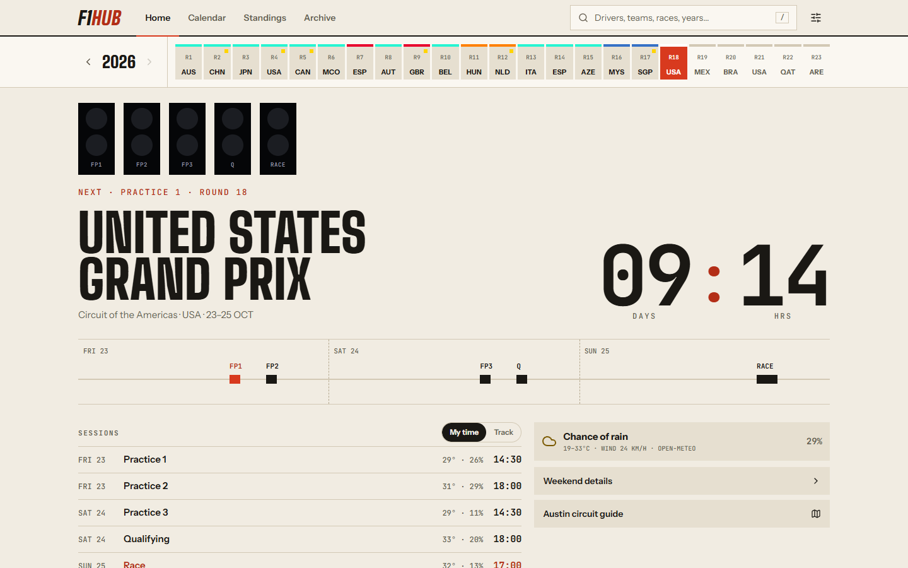
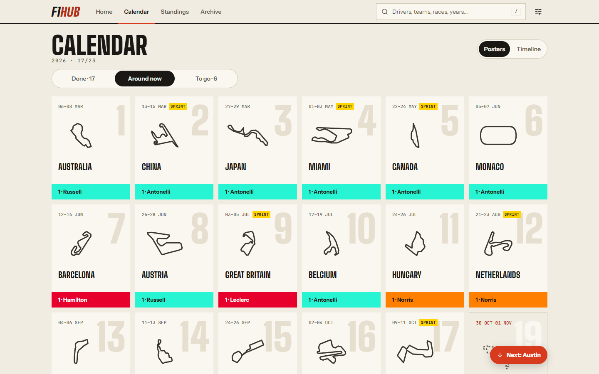
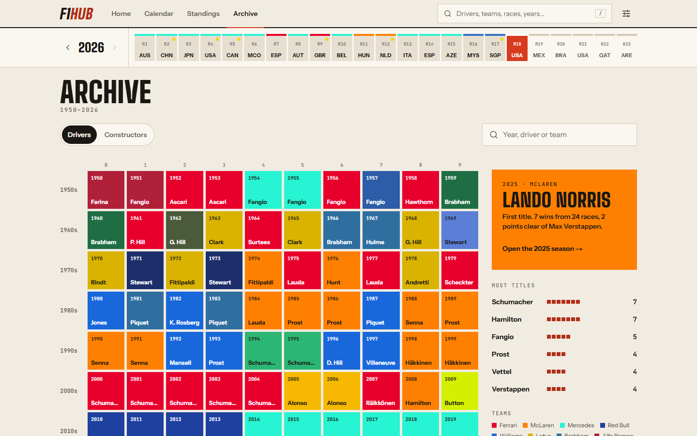
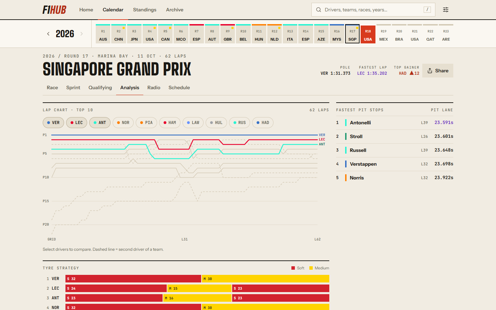
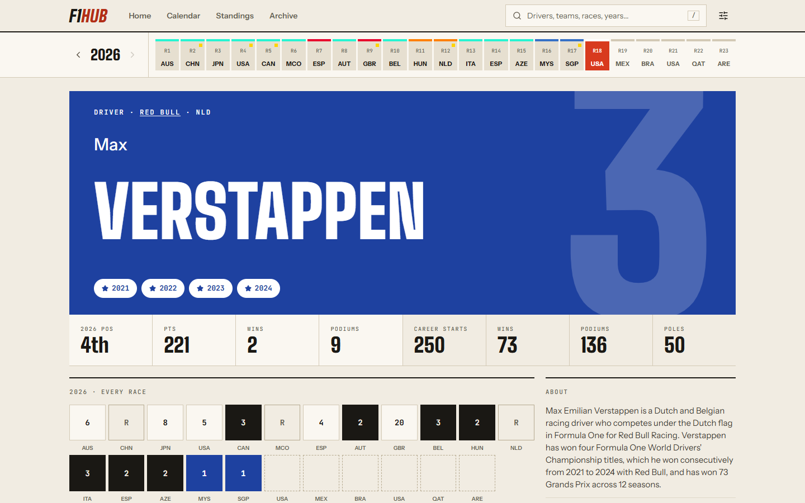
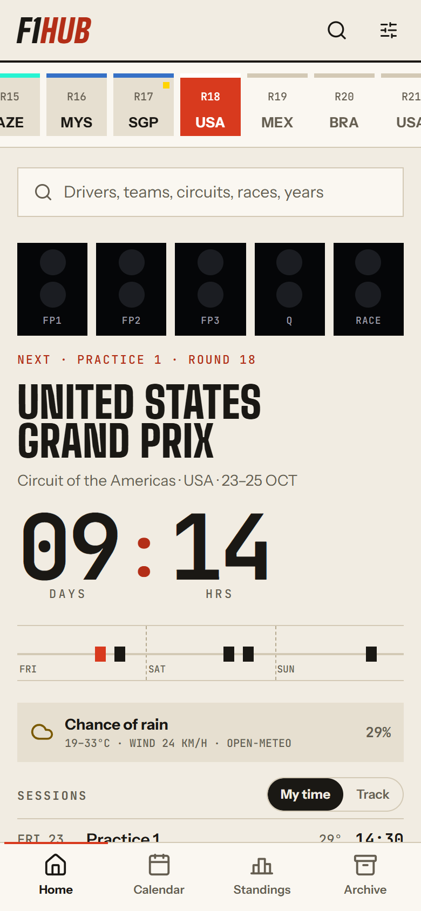
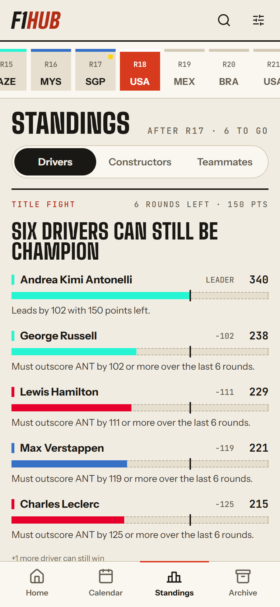
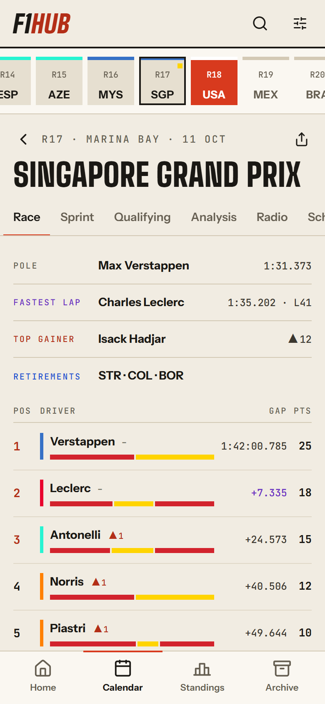

# F1HUB Web

The web version of [F1HUB](https://github.com/belmirofss/f1hub): Formula 1 calendar, live-season standings, race weekends, analysis and the full archive, in the browser and installable as an app.

It's styled like a printed race-day programme: warm paper, ink-black type, vermilion and royal blue, tall condensed headlines and hairline rules. A season spine under the header shows every round coloured by its winner's team.

**Live at https://webf1hub.vercel.app**

<p>
  
</p>
<p>
  
  
</p>
<p>
  
  
</p>
<p>
  
  
  
</p>

## What's in it

- **Home:** start lights for the weekend's sessions, the next race countdown with weather and every session in your time or track time, the last race, top 5 with recent form, the title fight and the closest teammate battle
- **Calendar** for the season as a wall of race posters or a timeline, coloured by the winning team
- **Standings** for drivers, constructors and teammates, with who can still win the title
- **Race weekends:** schedule and forecast, race, sprint and qualifying results, lap chart, tyre strategy, pit stops, team radio and race control
- **Archive** of every season since 1950 on one grid of champions, plus pages for every driver, team and circuit
- **Search** across all of it
- **Installable app** (PWA) that works offline for pages you've visited, with a 12/24-hour clock in Settings

## Data sources

- [Jolpica F1](https://github.com/jolpica/jolpica-f1): calendar, results, standings and history
- [OpenF1](https://openf1.org): tyres, team radio, race control and track maps (2023 onwards)
- [Open-Meteo](https://open-meteo.com): weekend forecast
- [Wikipedia](https://en.wikipedia.org/api/rest_v1/): driver, team and circuit bios

F1HUB never stores or collects information about you. It is independent and has no relationship with Formula 1.

## Running locally

You need Node.js 20.9 or newer.

```bash
git clone https://github.com/belmirofss/f1hub-web.git
cd f1hub-web
npm install
cp .env.example .env.local
npm run dev
```

Then open http://localhost:3000. No API keys are needed: every data source is public. The only variable in `.env.example` is the Google Search Console token, which only matters in production.

`npm run build` makes a production build, `npm start` serves it, `npm run lint` runs ESLint and `npm run format` runs Prettier. Local and preview builds tell search engines not to index them.

## Stack and deployment

Next.js (App Router) · TypeScript · Tailwind CSS. Hosted on Vercel, which deploys every push to `main`. The build plan is in [docs/PLAN.md](docs/PLAN.md), and the work was tracked as numbered GitHub issues.
